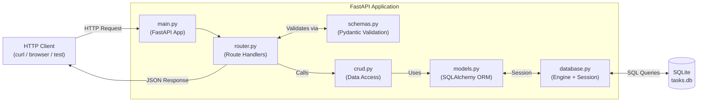

# Architecture Document

## 1. Architecture Overview

The Task Management REST API is a single-process Python application. FastAPI handles HTTP routing and request/response validation via Pydantic. SQLAlchemy manages all database interactions through an ORM layer, with SQLite as the embedded persistence engine. There is no async complexity, no background workers, no external services, and no caching layer. The application is designed to run locally with `uvicorn` as the ASGI server.

The design follows a layered approach: the HTTP layer (router) delegates to a data-access layer (CRUD), which communicates with the database through SQLAlchemy models. All three layers are kept in separate modules to enforce single responsibility.

---

## 2. Technology Stack

| Technology | Version Recommendation | Role |
|------------|------------------------|------|
| Python | 3.11+ | Runtime |
| FastAPI | 0.110+ | HTTP framework, OpenAPI generation |
| Pydantic | v2 (bundled with FastAPI 0.110+) | Request/response validation and serialization |
| SQLAlchemy | 2.0+ | ORM and database session management |
| SQLite | Built-in (Python stdlib) | Embedded relational database |
| Uvicorn | 0.29+ | ASGI server for running the app |
| Pytest | 7.x+ | Test framework |
| httpx | 0.27+ | HTTP client used by FastAPI's `TestClient` in tests |

No external database server, message broker, or cloud service is required.

---

## 3. Component Responsibilities

| Module | Responsibility |
|--------|----------------|
| `main.py` | Creates the FastAPI application instance, registers the router, and creates all database tables on startup via SQLAlchemy metadata. Entry point for `uvicorn`. |
| `database.py` | Configures the SQLAlchemy engine (pointing at the SQLite file), creates the `SessionLocal` factory, and defines the declarative `Base` that all ORM models extend. Provides the `get_db` dependency that yields a session and ensures it is closed after each request. |
| `models.py` | Defines the `Task` SQLAlchemy ORM model. Maps Python class attributes to the `tasks` database table and columns. |
| `schemas.py` | Defines the Pydantic models used as request bodies and response shapes: `TaskCreate`, `TaskUpdate`, `TaskResponse`. Keeps the API contract decoupled from the database model. |
| `router.py` | Contains all five FastAPI route handlers (`POST /tasks`, `GET /tasks`, `GET /tasks/{id}`, `PATCH /tasks/{id}`, `DELETE /tasks/{id}`). Handlers are thin: they validate input via Pydantic, call CRUD functions, and return serialized responses. |
| `crud.py` | Contains pure data-access functions that operate on a SQLAlchemy session. No HTTP or Pydantic logic lives here. Functions: `create_task`, `get_tasks`, `get_task`, `update_task`, `delete_task`. |

---

## 4. REST API Endpoint Design

| Method | Path | Request Body | Response Body | Status Codes |
|--------|------|--------------|---------------|--------------|
| POST | `/tasks` | `{"title": string, "description": string, "status"?: "todo" \| "in_progress" \| "done"}` | Task object: `{"id": int, "title": string, "description": string, "status": string}` | 201 Created, 422 Unprocessable Entity (invalid status or missing required field) |
| GET | `/tasks` | — | Array of task objects: `[{...}, ...]` — empty array `[]` when no tasks exist | 200 OK |
| GET | `/tasks/{id}` | — | Single task object | 200 OK, 404 Not Found (`"Task with ID {id} does not exist"`) |
| PATCH | `/tasks/{id}` | `{"title"?: string, "description"?: string, "status"?: "todo" \| "in_progress" \| "done"}` (all fields optional; at least one expected) | Full updated task object | 200 OK, 404 Not Found, 422 Unprocessable Entity |
| DELETE | `/tasks/{id}` | — | `{"message": "Task with ID {id} has been deleted"}` | 200 OK, 404 Not Found |

**Notes:**
- The `id` field is never accepted in any request body.
- `status` defaults to `"todo"` when omitted on creation (FR-007, Assumption A-01).
- 404 responses use FastAPI's standard `HTTPException` JSON envelope: `{"detail": "Task with ID {id} does not exist"}` (FR-008). The `detail` key is FastAPI's built-in error wrapper; the message text matches FR-008 exactly.
- 422 is returned automatically by FastAPI/Pydantic when a field value is invalid (AC-007).

---

## 5. Data Model

### SQLAlchemy ORM Model — `Task`

| Attribute | SQLAlchemy Type | Constraints | Notes |
|-----------|----------------|-------------|-------|
| `id` | `Integer` | Primary Key, autoincrement=True | System-assigned; never accepted from clients |
| `title` | `String` | NOT NULL | User-provided task title |
| `description` | `String` | NOT NULL | User-provided task description |
| `status` | `String` | NOT NULL, default=`"todo"` | Constrained to `todo`, `in_progress`, `done` by Pydantic; stored as plain string in SQLite |

### SQLite Schema (DDL)

```sql
CREATE TABLE tasks (
    id          INTEGER PRIMARY KEY AUTOINCREMENT,
    title       TEXT    NOT NULL,
    description TEXT    NOT NULL,
    status      TEXT    NOT NULL DEFAULT 'todo'
);
```

### Pydantic Schemas

**`TaskCreate`** — POST request body:
- `title`: `str` (required)
- `description`: `str` (required)
- `status`: `Literal["todo", "in_progress", "done"]` (optional, default `"todo"`)

**`TaskUpdate`** — PATCH request body:
- `title`: `Optional[str]` (optional)
- `description`: `Optional[str]` (optional)
- `status`: `Optional[Literal["todo", "in_progress", "done"]]` (optional)

**`TaskResponse`** — all response bodies that return a task:
- `id`: `int`
- `title`: `str`
- `description`: `str`
- `status`: `str`

---

## 6. Data Flow

### POST /tasks — Create a task

1. Client sends `POST /tasks` with JSON body `{title, description, status?}`.
2. Uvicorn passes the request to the FastAPI app.
3. FastAPI validates the body against `TaskCreate`; returns 422 immediately if validation fails.
4. The `POST /tasks` route handler in `router.py` receives the validated `TaskCreate` object.
5. The handler calls `crud.create_task(db, task_data)`.
6. `create_task` instantiates a `Task` ORM model, adds it to the SQLAlchemy session, commits, refreshes to load the new `id`, and returns the `Task` instance.
7. The handler wraps the returned `Task` in a `TaskResponse` and returns HTTP 201.

### GET /tasks — List all tasks

1. Client sends `GET /tasks`.
2. The route handler in `router.py` calls `crud.get_tasks(db)`.
3. `get_tasks` executes `SELECT * FROM tasks`, returns a list of `Task` ORM objects (empty list if none).
4. The handler serializes the list to `List[TaskResponse]` and returns HTTP 200.

### GET /tasks/{id} — Get a single task

1. Client sends `GET /tasks/42`.
2. FastAPI extracts path parameter `id=42`.
3. The handler calls `crud.get_task(db, 42)`.
4. `get_task` executes `SELECT * FROM tasks WHERE id = 42`.
5. If no row found: handler raises `HTTPException(404, "Task with ID 42 does not exist")`.
6. If found: handler returns the `Task` as `TaskResponse`, HTTP 200.

### PATCH /tasks/{id} — Partially update a task

1. Client sends `PATCH /tasks/42` with a partial body, e.g. `{"status": "done"}`.
2. FastAPI validates the body against `TaskUpdate` (all fields optional); returns 422 on bad status value.
3. The handler calls `crud.get_task(db, 42)`; raises 404 if not found.
4. The handler calls `crud.update_task(db, task, update_data)`.
5. `update_task` iterates over only the fields that were explicitly supplied in the request (using `model_dump(exclude_unset=True)`) and sets them on the ORM object, then commits and refreshes.
6. Handler returns the updated `Task` as `TaskResponse`, HTTP 200.

### DELETE /tasks/{id} — Delete a task

1. Client sends `DELETE /tasks/42`.
2. The handler calls `crud.get_task(db, 42)`; raises 404 if not found.
3. The handler calls `crud.delete_task(db, task)`.
4. `delete_task` deletes the ORM object from the session and commits.
5. Handler returns `{"message": "Task with ID 42 has been deleted"}`, HTTP 200.

---

## 7. Project File Structure

```
SDLC-CLAUDE/
├── src/
│   ├── __init__.py
│   ├── main.py          # App factory; registers router; creates DB tables on startup
│   ├── database.py      # Engine, SessionLocal, Base, get_db dependency
│   ├── models.py        # SQLAlchemy Task ORM model
│   ├── schemas.py       # Pydantic schemas: TaskCreate, TaskUpdate, TaskResponse
│   ├── router.py        # FastAPI router with all 5 route handlers
│   └── crud.py          # Database access functions: create, read, update, delete
├── tests/
│   ├── __init__.py
│   ├── conftest.py      # Pytest fixtures: in-memory SQLite engine, test client
│   └── test_tasks.py    # Happy-path tests for all 5 endpoints
├── requirements.txt
└── docs/
    └── plans/
        ├── requirements.md
        └── architecture.md
```

---

## 8. Mermaid Architecture Diagram



---

## 9. Key Design Decisions

### FastAPI over Flask

FastAPI is chosen over Flask because it provides built-in Pydantic integration for automatic request validation and response serialization, automatic OpenAPI/Swagger UI generation, and native support for Python type annotations. These capabilities directly reduce boilerplate for this CRUD API and make the 422 validation requirement (AC-007) a zero-cost built-in behavior rather than custom code.

### SQLAlchemy ORM over raw SQL

SQLAlchemy ORM is chosen over raw `sqlite3` calls for three reasons: (1) the ORM model in `models.py` serves as a single source of truth for the schema, which the `database.py` startup call (`Base.metadata.create_all`) can use to create the table automatically; (2) ORM objects are easier to serialize via Pydantic's `from_attributes` mode; (3) the session-based transaction model (`add`, `commit`, `refresh`) avoids manual cursor management. Raw SQL would be equally valid for a project this size, but ORM reduces error-prone manual string construction.

### Synchronous (non-async) SQLAlchemy

The application uses synchronous SQLAlchemy sessions (`sessionmaker`, not `AsyncSession`). SQLite does not benefit from async I/O because it is a file-level lock-based database. Using synchronous sessions keeps the code straightforward — no `async def`, no `await`, no `asynccontextmanager` wrappers — which is the right tradeoff for a single-user local API.

### Separate `crud.py` from `router.py`

Route handlers in `router.py` are kept thin: they translate HTTP concerns (path params, request bodies, status codes, error responses) but contain no SQL. All SQL logic lives in `crud.py`. This separation makes CRUD functions independently unit-testable without an HTTP layer, and keeps route handlers readable.

### Pydantic schemas separate from ORM models

`TaskCreate`, `TaskUpdate`, and `TaskResponse` in `schemas.py` are distinct from the SQLAlchemy `Task` model in `models.py`. This separation ensures that the API contract (what fields clients send and receive) is decoupled from the database schema (what columns exist). For example, `id` is excluded from `TaskCreate` and `TaskUpdate` entirely, making it impossible for a client to supply it, without any additional code.

### In-memory SQLite for tests

The `conftest.py` fixture will configure SQLAlchemy to use `sqlite:///:memory:` for tests. This isolates tests from the development database file, allows each test session to start with a clean state, and requires no test teardown beyond the session scope.

### Single SQLite file for the application database

The database is stored as a local file (`tasks.db` at the project root or configurable via an environment variable). This satisfies NFR-002 and NFR-004 with no external infrastructure. A new database file is created automatically on first run if it does not exist.
