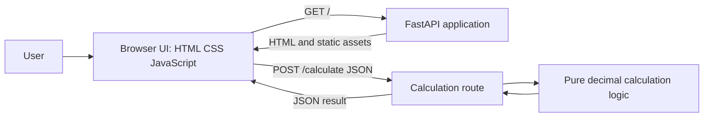

# Calculator Web Application Architecture

## 1. Overview

A local, stateless web application. FastAPI serves the calculator page and a JSON calculation endpoint. The browser collects two numeric values and an operation, requests a calculation, and displays the result. No database or persistent server-side state is used.

## 2. Components And Responsibilities

- FastAPI application (`src/main.py`): creates the app, serves the calculator page, mounts static assets, and registers the calculation route.
- Calculator route (`src/routers/calculator.py`): validates the calculation request and returns the computed result.
- Calculation logic (`src/calculator.py`): performs addition, subtraction, multiplication, and division using decimal arithmetic; contains no I/O or persistence.
- Request/response schemas (`src/schemas.py`): define operands, supported operation, and result.
- Static frontend (`src/static/`): HTML form, CSS presentation, and JavaScript for submission, result display, and Clear behavior.
- Pytest suite (`tests/`): verifies API calculations and local page/static-asset serving.

## 3. API Design

### `POST /calculate`

Request JSON:

```json
{
  "first_number": "10",
  "second_number": "5",
  "operation": "addition"
}
```

Supported operations: `addition`, `subtraction`, `multiplication`, and `division`.

Successful response JSON:

```json
{
  "result": "15"
}
```

Decimal operands/results preserve the decimal input and avoid introducing binary floating-point display artifacts. A zero divisor is outside the positive acceptance examples; the API should reject it as invalid input rather than crash, with the exact client error represented as a validation response.

## 4. Data And State

There is no persistent data model. Numeric values, selected operation, and displayed result live only in the current browser page/request. Use decimal arithmetic in the backend.

## 5. User And Request Flow

1. Browser requests `GET /`; FastAPI returns the calculator HTML and serves its CSS/JavaScript from `/static/`.
2. User enters two values, selects an operation, and clicks Calculate.
3. Frontend submits JSON to `POST /calculate`.
4. FastAPI validates the request, calls pure calculation logic, and returns the result.
5. Frontend displays the result without reloading the page.
6. Clear empties both inputs and the result and returns the operation selector to Addition, confirmed by the user during implementation-plan approval.

## 6. Architecture Diagram



## 7. Scope And Decisions

- No database, authentication, history, cloud deployment, or scientific operations.
- The existing Task Management API is not part of the approved KAN-25 application scope. Its app wiring, persistence dependencies, and task-specific tests must be retired/replaced as specified in the implementation plan after approval; preserve local database files unless the user explicitly requests deletion.
- Addition is the confirmed default operation selection, including after Clear.