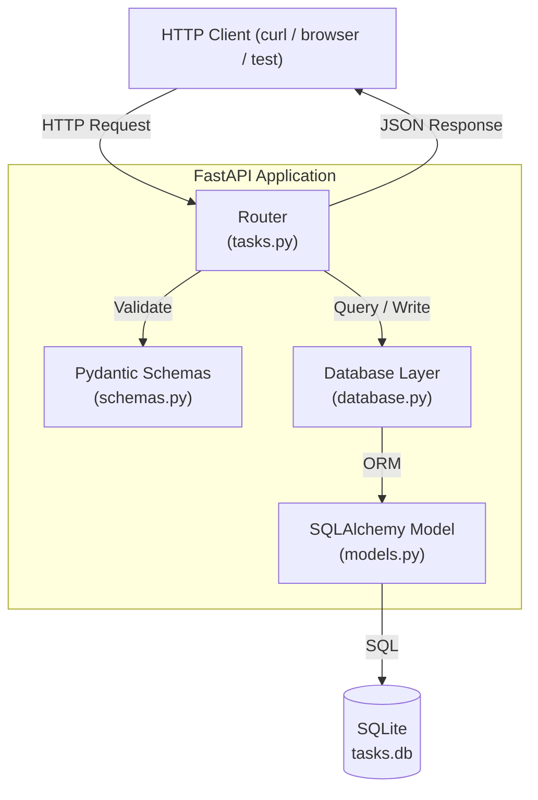

# Architecture Design
## Task Management REST API

**Workflow ID:** WF-2026-001
**Stage:** Architecture
**Author:** Solution Architect Agent
**Date:** 2026-10-17
**Input:** docs/plans/requirements.md

---

## 1. Architecture Overview

A single-process, monolithic FastAPI application with SQLite persistence. No external services, message queues, or cloud infrastructure. The app runs locally and serves a REST API for task CRUD operations.

---

## 2. Architecture Diagram



---

## 3. Components and Responsibilities

| Component | File | Responsibility |
|-----------|------|----------------|
| Entry point | `src/main.py` | Creates the FastAPI app, includes the router |
| Router | `src/routers/tasks.py` | Defines all 5 REST endpoints |
| Schemas | `src/schemas.py` | Pydantic models for request validation and response serialization |
| Models | `src/models.py` | SQLAlchemy ORM model for the Task table |
| Database | `src/database.py` | SQLite engine, session factory, table creation |
| Dependencies | `requirements.txt` | fastapi, uvicorn, sqlalchemy, pydantic |

---

## 4. Data Model

### Table: `tasks`

| Column      | Type         | Constraints                          |
|-------------|--------------|--------------------------------------|
| id          | INTEGER      | PRIMARY KEY, AUTOINCREMENT           |
| title       | VARCHAR(255) | NOT NULL                             |
| description | TEXT         | NOT NULL                             |
| status      | VARCHAR(20)  | NOT NULL, default `todo`             |

**Valid status values:** `todo`, `in_progress`, `done`

---

## 5. REST API Endpoints

| Method | Path          | Request Body                        | Success Response | Error Response         |
|--------|---------------|-------------------------------------|------------------|------------------------|
| POST   | /tasks        | `{ title, description, status? }`  | 201 + task object | 422 validation error  |
| GET    | /tasks        | —                                   | 200 + task array | —                      |
| GET    | /tasks/{id}   | —                                   | 200 + task object | 404 task not found    |
| PATCH  | /tasks/{id}   | `{ title?, description?, status? }` | 200 + task object | 404 task not found    |
| DELETE | /tasks/{id}   | —                                   | 200 + message    | 404 task not found    |

---

## 6. Pydantic Schemas

```python
# Create — all required except status (defaults to "todo")
class TaskCreate(BaseModel):
    title: str
    description: str
    status: Literal["todo", "in_progress", "done"] = "todo"

# Partial update — all optional
class TaskUpdate(BaseModel):
    title: Optional[str] = None
    description: Optional[str] = None
    status: Optional[Literal["todo", "in_progress", "done"]] = None

# Response — always includes id
class TaskResponse(BaseModel):
    id: int
    title: str
    description: str
    status: str

    class Config:
        from_attributes = True
```

---

## 7. Data Flow

### Create Task (POST /tasks)
1. Client sends `{ title, description, status }` to `POST /tasks`
2. FastAPI validates request against `TaskCreate` schema
3. Router creates a SQLAlchemy `Task` object and commits to SQLite
4. Router returns `TaskResponse` with assigned `id`, status `201`

### Get All Tasks (GET /tasks)
1. Client sends `GET /tasks`
2. Router queries `SELECT * FROM tasks`
3. Returns list of `TaskResponse` objects, status `200`

### Get Task by ID (GET /tasks/{id})
1. Client sends `GET /tasks/1`
2. Router queries `SELECT * FROM tasks WHERE id = 1`
3. If not found: returns `404` with `"Task with ID 1 does not exist"`
4. If found: returns `TaskResponse`, status `200`

### Partial Update (PATCH /tasks/{id})
1. Client sends `PATCH /tasks/1` with subset of fields
2. Router fetches task; 404 if not found
3. Updates only the provided fields on the ORM object
4. Commits and returns updated `TaskResponse`, status `200`

### Delete Task (DELETE /tasks/{id})
1. Client sends `DELETE /tasks/1`
2. Router fetches task; 404 if not found
3. Deletes record, commits
4. Returns `{ "message": "Task with ID 1 deleted successfully" }`, status `200`

---

## 8. Project File Structure

```
src/
├── main.py           # FastAPI app instantiation
├── database.py       # SQLite engine, session, Base
├── models.py         # Task ORM model
├── schemas.py        # Pydantic schemas
└── routers/
    └── tasks.py      # All task endpoints
requirements.txt
tests/
└── test_tasks.py     # pytest test suite (Stage 7)
```

---

## 9. Dependencies

```
fastapi
uvicorn[standard]
sqlalchemy
pydantic
pytest
httpx
```

---

## 10. Architecture Decisions

| Decision | Choice | Reason |
|----------|--------|--------|
| Web framework | FastAPI | Requirement; built-in validation via Pydantic |
| ORM | SQLAlchemy (Core + ORM) | Standard Python ORM for SQLite; no extra setup |
| Database | SQLite file (`tasks.db`) | Requirement; zero-config, local persistence |
| Update method | PATCH (partial) | Per clarified requirement |
| Status enforcement | Pydantic `Literal` type | Validated at request time, no separate validator needed |
| ID generation | SQLite AUTOINCREMENT | Requirement; simplest approach |
| No auth layer | Intentional | Out of scope per requirements |
