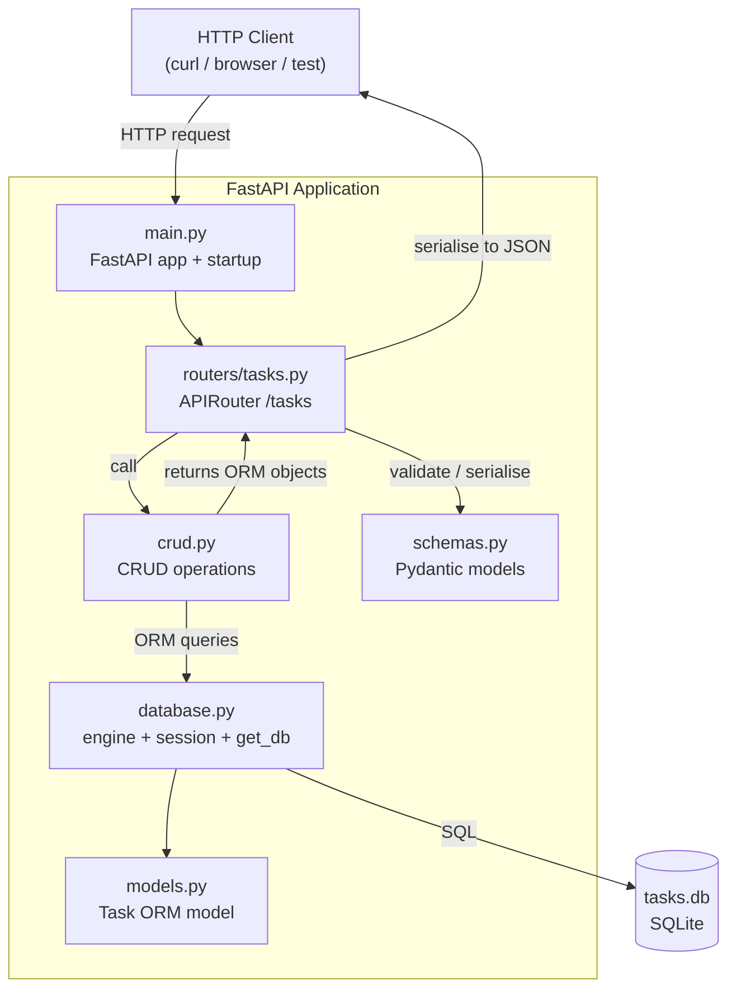

# Architecture Design

## 1. Document Details

| Field         | Value |
|---------------|-------|
| JIRA Story    | KAN-31 |
| Project       | Task Management REST API |
| Workflow ID   | WF-2026-004 |
| Prepared by   | Solution Architect Agent |
| Date          | 2026-11-01 |
| Status        | DRAFT — Pending Design Review |

---

## 2. Architecture Overview

The Task Management REST API is a single-process, locally-runnable HTTP service built on FastAPI. It exposes five CRUD endpoints backed by a SQLite database accessed through SQLAlchemy. Pydantic models enforce request validation and response serialisation. There is no authentication, no external infrastructure, and no background workers.

The design follows a three-layer layout:

```
HTTP layer  →  Business / Routing layer  →  Persistence layer
(FastAPI)      (Router + CRUD)              (SQLAlchemy + SQLite)
```

---

## 3. Technology Stack

| Component      | Technology          | Rationale |
|----------------|---------------------|-----------|
| Language       | Python 3.10+        | Required by NFR-001 |
| Web framework  | FastAPI             | Required by NFR-001; automatic OpenAPI docs |
| ASGI server    | Uvicorn             | Standard FastAPI runtime |
| Data layer     | SQLAlchemy 2.x      | ORM over SQLite; avoids raw SQL string building |
| Database       | SQLite (file-based) | Required by NFR-002; bundled with Python stdlib |
| Validation     | Pydantic v2         | Integrated with FastAPI; provides schema enforcement |
| Testing        | Pytest + HTTPX      | Required by D-04; HTTPX drives the FastAPI test client |

---

## 4. Component Breakdown

### 4.1 Application Entry Point — `src/main.py`

Responsibilities:
- Create the `FastAPI` application instance.
- Register the tasks router under the `/tasks` prefix.
- Trigger database table creation on startup via `Base.metadata.create_all`.
- Export the `app` object used by Uvicorn.

### 4.2 Database Module — `src/database.py`

Responsibilities:
- Create the SQLAlchemy `engine` pointing to `tasks.db` in the project root.
- Define `SessionLocal` (a `sessionmaker` factory).
- Expose `Base` (declarative base) for model registration.
- Provide a `get_db` dependency function that yields a session and closes it after each request.

### 4.3 ORM Model — `src/models.py`

Responsibilities:
- Define the `Task` SQLAlchemy model mapped to the `tasks` table.
- Declare columns: `id` (Integer, primary key, autoincrement), `title` (String, not null), `description` (String, not null), `status` (String, not null, default `"todo"`).

### 4.4 Pydantic Schemas — `src/schemas.py`

Responsibilities:
- `TaskCreate` — request body for POST /tasks (title, description required; status optional, defaults to `"todo"`).
- `TaskUpdate` — request body for PATCH /tasks/{id} (all fields optional).
- `TaskResponse` — full task representation returned in all responses (id, title, description, status). Configured with `model_config = ConfigDict(from_attributes=True)` for ORM compatibility.
- `StatusEnum` — `Literal["todo", "in_progress", "done"]` used in both create and update schemas to enforce allowed values (per A-02).

### 4.5 CRUD Layer — `src/crud.py`

Responsibilities:
- `create_task(db, task_in)` — insert a new Task row; return the persisted object.
- `get_tasks(db)` — return all Task rows as a list.
- `get_task(db, task_id)` — return the Task with the given id; return `None` if not found.
- `update_task(db, task_id, task_in)` — apply partial field updates; return the updated object (or `None`).
- `delete_task(db, task_id)` — delete the Task row; return the deleted object (or `None`).

Each function accepts a SQLAlchemy `Session` as its first argument. No business logic lives here — only database operations.

### 4.6 Router — `src/routers/tasks.py`

Responsibilities:
- Define an `APIRouter` with prefix `/tasks`.
- Implement the five endpoint handlers (see Section 6).
- Inject the database session via `Depends(get_db)`.
- Return appropriate HTTP status codes as specified in acceptance criteria.
- Call CRUD functions; return `TaskResponse` instances (or lists thereof).

### 4.7 Test Suite — `tests/test_tasks.py`

Responsibilities:
- Use `pytest` with FastAPI's `TestClient` (backed by HTTPX).
- Override the `get_db` dependency to use an in-memory SQLite database so tests are isolated and leave no files on disk.
- Cover one happy-path test per acceptance criterion (AC-001 through AC-005).

---

## 5. Data Model

### 5.1 SQLite Table: `tasks`

| Column      | SQLite Type | Constraints                          |
|-------------|-------------|--------------------------------------|
| id          | INTEGER     | PRIMARY KEY AUTOINCREMENT            |
| title       | TEXT        | NOT NULL                             |
| description | TEXT        | NOT NULL                             |
| status      | TEXT        | NOT NULL, DEFAULT `'todo'`           |

### 5.2 Allowed Status Values

`todo` | `in_progress` | `done`

Enforced at the Pydantic schema layer (not at the SQLite layer, to keep the schema simple).

---

## 6. REST API Endpoint Specification

| Method | Path            | Request Body      | Success Response     | Requirement |
|--------|-----------------|-------------------|----------------------|-------------|
| POST   | /tasks          | `TaskCreate`      | 201 + `TaskResponse` | FR-001, AC-001 |
| GET    | /tasks          | —                 | 200 + `TaskResponse[]` | FR-002, AC-002 |
| GET    | /tasks/{id}     | —                 | 200 + `TaskResponse` | FR-003, AC-003 |
| PATCH  | /tasks/{id}     | `TaskUpdate`      | 200 + `TaskResponse` | FR-004, AC-004 |
| DELETE | /tasks/{id}     | —                 | 204 No Content       | FR-005, AC-005 |

All endpoints produce and consume `application/json` (except DELETE which returns no body).

---

## 7. Data Flow

### 7.1 Create Task (POST /tasks)

```
Client → POST /tasks {title, description, status?}
       → Router: validate body against TaskCreate
       → crud.create_task(db, task_in)
       → SQLite INSERT INTO tasks
       ← 201 Created {id, title, description, status}
```

### 7.2 List Tasks (GET /tasks)

```
Client → GET /tasks
       → Router: no body validation required
       → crud.get_tasks(db)
       → SQLite SELECT * FROM tasks
       ← 200 OK [{id, title, description, status}, ...]
```

### 7.3 Get Single Task (GET /tasks/{id})

```
Client → GET /tasks/{id}
       → Router: path parameter validated as integer
       → crud.get_task(db, id)
       → SQLite SELECT * FROM tasks WHERE id = ?
       ← 200 OK {id, title, description, status}
```

### 7.4 Update Task (PATCH /tasks/{id})

```
Client → PATCH /tasks/{id} {title?, description?, status?}
       → Router: validate body against TaskUpdate (all optional)
       → crud.update_task(db, id, task_in)
       → SQLite UPDATE tasks SET ... WHERE id = ?
       ← 200 OK {id, title, description, status}
```

### 7.5 Delete Task (DELETE /tasks/{id})

```
Client → DELETE /tasks/{id}
       → Router: path parameter validated as integer
       → crud.delete_task(db, id)
       → SQLite DELETE FROM tasks WHERE id = ?
       ← 204 No Content
```

---

## 8. Directory Structure

```
SDLC-CLAUDE/
├── src/
│   ├── __init__.py
│   ├── main.py             ← FastAPI app, startup, router registration
│   ├── database.py         ← engine, SessionLocal, Base, get_db
│   ├── models.py           ← Task ORM model
│   ├── schemas.py          ← TaskCreate, TaskUpdate, TaskResponse, StatusEnum
│   ├── crud.py             ← create/get/update/delete task functions
│   └── routers/
│       ├── __init__.py
│       └── tasks.py        ← APIRouter with 5 endpoints
├── tests/
│   └── test_tasks.py       ← pytest happy-path tests (in-memory DB)
├── tasks.db                ← SQLite file (created at runtime, gitignored)
├── requirements.txt        ← fastapi, uvicorn, sqlalchemy, httpx, pytest
└── docs/
    └── plans/
        ├── requirements.md
        └── architecture.md ← this document
```

> `tasks.db` must be added to `.gitignore` to prevent committing runtime data.

---

## 9. Dependency Injection Diagram

```
FastAPI app
└── /tasks router
    └── endpoint handlers
        └── Depends(get_db)
            └── SessionLocal()  →  SQLite tasks.db
```

---

## 10. Architecture Diagram (Mermaid)



---

## 11. Constraints and Design Decisions

| # | Decision | Rationale |
|---|----------|-----------|
| DD-01 | SQLAlchemy ORM instead of raw `sqlite3` | Cleaner query code; avoids string-formatted SQL; consistent with existing project conventions |
| DD-02 | Single `tasks.db` file in project root | Simplest path for a locally-run service; no configuration needed |
| DD-03 | In-memory SQLite for tests | Tests remain isolated and leave no artefacts; matches the pattern from previous workflow |
| DD-04 | `StatusEnum` enforced in Pydantic only | Keeps the SQLite schema minimal; validation at the API layer is sufficient for happy-path scope |
| DD-05 | PATCH semantics for partial update | AC-004 requires that only supplied fields are updated; PUT would replace the entire resource |
| DD-06 | DELETE returns 204 No Content | Standard REST convention; AC-005 requires this explicitly |
| DD-07 | No authentication or middleware | A-04 and A-07 exclude auth and multi-user; no added complexity |
| DD-08 | Tasks router registered at `/tasks` prefix | Clean URL namespace; router file stays free of prefix duplication |

---

## 12. Requirements Coverage

| Requirement | Addressed by |
|-------------|--------------|
| FR-001 (create task) | POST /tasks → crud.create_task |
| FR-002 (list tasks) | GET /tasks → crud.get_tasks |
| FR-003 (get by id) | GET /tasks/{id} → crud.get_task |
| FR-004 (partial update) | PATCH /tasks/{id} → crud.update_task |
| FR-005 (delete) | DELETE /tasks/{id} → crud.delete_task |
| NFR-001 (Python + FastAPI) | FastAPI application on Python 3.10+ |
| NFR-002 (SQLite) | SQLAlchemy engine targeting tasks.db |
| NFR-003 (JSON responses) | FastAPI + Pydantic automatic JSON serialisation |
| NFR-004 (local execution) | Uvicorn on localhost; no cloud infra |

---

## 13. Out of Scope (confirmed)

The following are excluded per requirements Section 9 and are not represented in this architecture:

- Authentication / authorisation
- Pagination or filtering on GET /tasks
- Task priorities, due dates, tags, or attachments
- Error-path test coverage (404 not covered by tests, though the 404 HTTP response itself must still be emitted by the framework)
- Containerisation or cloud deployment
