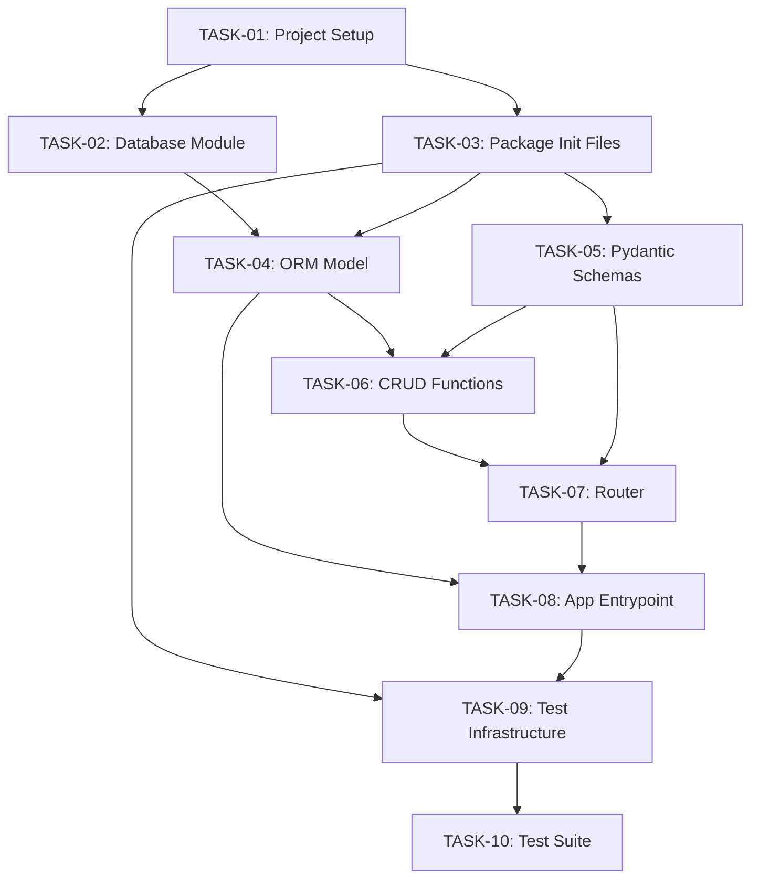

# Implementation Plan

**JIRA Story:** KAN-24 — Task Management REST API
**Prepared by:** Implementation Planner Agent
**Date:** 2026-10-17
**Input Artifacts:**
- `docs/plans/requirements.md` (Approved 2026-10-17)
- `docs/plans/architecture.md` (Approved with changes 2026-10-17)
- `docs/plans/design-review.md` (APPROVED WITH MINOR NOTES 2026-10-17)

---

## 1. Overview

The application to be built is a Task Management REST API. It exposes five CRUD endpoints (`POST /tasks`, `GET /tasks`, `GET /tasks/{id}`, `PATCH /tasks/{id}`, `DELETE /tasks/{id}`) implemented with FastAPI, persisting data in an embedded SQLite database via SQLAlchemy ORM. A Pytest suite covers happy-path scenarios for every endpoint using an in-memory SQLite database.

**Implementation strategy:** Build in strict dependency order — project scaffolding first, then the database layer, ORM model, Pydantic schemas, CRUD functions, router, app entrypoint, test infrastructure, and finally tests. Each group of related files constitutes one logical commit.

**Prior-run state note:** A previous execution partially implemented the project. The following files already exist and must be verified for correctness before being considered done:

| File | Status |
|------|--------|
| `requirements.txt` | EXISTS |
| `requirements-test.txt` | EXISTS |
| `.env.example` | EXISTS |
| `.gitignore` | EXISTS |
| `src/database.py` | EXISTS |
| `src/main.py` | EXISTS |
| `src/models.py` | EXISTS |
| `src/schemas.py` | EXISTS |
| `src/routers/__init__.py` | EXISTS |
| `src/routers/tasks.py` | EXISTS |
| `tests/test_tasks.py` | EXISTS |

The following files are **absent** and must be created:

| File | Status |
|------|--------|
| `src/__init__.py` | MISSING |
| `src/crud.py` | MISSING — required by architecture |
| `tests/__init__.py` | MISSING |
| `tests/conftest.py` | MISSING |

> **Note on file layout:** The architecture document specifies `src/router.py` as a flat file. The prior run instead created `src/routers/tasks.py` (a sub-package). This plan adopts the `src/routers/tasks.py` layout as-is, which is equally valid and already in place.

---

## 2. Branch Strategy

| Item | Value |
|------|-------|
| Feature branch | `feature/task-management-api` |
| Base branch | `main` |
| Commit strategy | One logical commit per task group (see task groupings in Section 3) |
| Merge strategy | Squash-merge via GitHub PR after all tests pass and code review is approved |

---

## 3. Implementation Tasks

---

### TASK-01 — Project Setup

**Description:**
Establish the Python project scaffold. Verify or create all root-level configuration files:
`requirements.txt`, `requirements-test.txt`, `.env.example`, and `.gitignore`. These files are prerequisites for all subsequent tasks because they define the runtime environment and protect sensitive files from being committed.

**Files to create or modify:**

| File | Action |
|------|--------|
| `requirements.txt` | Verify exists and contains: `fastapi`, `sqlalchemy`, `uvicorn` |
| `requirements-test.txt` | Verify exists and contains: `pytest`, `httpx` |
| `.env.example` | Verify exists; should document `DATABASE_URL` variable |
| `.gitignore` | Verify exists; must include `*.db`, `__pycache__/`, `.env`, `*.pyc` |

**Dependencies:** None
**Complexity:** LOW

---

### TASK-02 — Database Module

**Description:**
Implement `src/database.py`. This module configures the SQLAlchemy engine (pointing at the SQLite file), creates the `SessionLocal` factory, defines the declarative `Base` that all ORM models must extend, and exposes the `get_db` FastAPI dependency that yields a database session and guarantees it is closed after each request.

Per design review finding DR-003: the default database path shall be `./tasks.db` (relative to the working directory, i.e., the project root). The connection URL may be overridden via the `DATABASE_URL` environment variable.

**Files to create or modify:**

| File | Action |
|------|--------|
| `src/database.py` | Verify / create — engine, `SessionLocal`, `Base`, `get_db` |

**Dependencies:** TASK-01
**Complexity:** LOW

---

### TASK-03 — Package Init Files

**Description:**
Create the missing `__init__.py` files that make `src/` and `tests/` valid Python packages. Without these, Python cannot resolve imports between modules (e.g., `from src.database import Base`) and pytest will fail to collect test files.

**Files to create or modify:**

| File | Action |
|------|--------|
| `src/__init__.py` | CREATE — empty file |
| `tests/__init__.py` | CREATE — empty file |

**Dependencies:** TASK-01
**Complexity:** LOW

---

### TASK-04 — ORM Model

**Description:**
Implement `src/models.py`. Define the `Task` SQLAlchemy ORM model that maps to the `tasks` table. The model must include all four columns from the approved data model:

| Column | Type | Constraint |
|--------|------|------------|
| `id` | Integer | Primary Key, autoincrement=True |
| `title` | String | NOT NULL |
| `description` | String | NOT NULL |
| `status` | String | NOT NULL, server_default=`"todo"` |

The `Task` class must extend `Base` imported from `src/database.py`.

**Files to create or modify:**

| File | Action |
|------|--------|
| `src/models.py` | Verify / create — `Task` ORM model |

**Dependencies:** TASK-02, TASK-03
**Complexity:** LOW

---

### TASK-05 — Pydantic Schemas

**Description:**
Implement `src/schemas.py`. Define the three Pydantic v2 schemas that decouple the API contract from the database model:

- `TaskCreate` — POST request body: `title` (required str), `description` (required str), `status` (optional Literal, default `"todo"`). The `id` field must NOT be present.
- `TaskUpdate` — PATCH request body: all three task fields are optional (`Optional`). Used with `model_dump(exclude_unset=True)` to implement partial-update semantics.
- `TaskResponse` — all task responses: `id` (int), `title` (str), `description` (str), `status` (str or Literal). Must include `model_config = ConfigDict(from_attributes=True)` (Pydantic v2 requirement for ORM object serialisation — see design review DR-004).

**Files to create or modify:**

| File | Action |
|------|--------|
| `src/schemas.py` | Verify / create — `TaskCreate`, `TaskUpdate`, `TaskResponse` |

**Dependencies:** TASK-03
**Complexity:** LOW

---

### TASK-06 — CRUD Functions

**Description:**
Implement `src/crud.py`. This file does not exist and must be created. It is the data-access layer: all SQL logic lives here; no HTTP or Pydantic logic belongs in this module. The five functions required are:

| Function | Signature summary | Behaviour |
|----------|------------------|-----------|
| `create_task` | `(db, task_data: TaskCreate) -> Task` | Instantiate `Task` ORM object, `db.add`, `db.commit`, `db.refresh`, return object |
| `get_tasks` | `(db) -> List[Task]` | `SELECT * FROM tasks`, return list (empty list if none) |
| `get_task` | `(db, task_id: int) -> Task or None` | `SELECT ... WHERE id = task_id`, return object or `None` |
| `update_task` | `(db, task: Task, update_data: TaskUpdate) -> Task` | Iterate `update_data.model_dump(exclude_unset=True)`, `setattr` on ORM object, `db.commit`, `db.refresh`, return updated object |
| `delete_task` | `(db, task: Task) -> None` | `db.delete(task)`, `db.commit` |

**Files to create or modify:**

| File | Action |
|------|--------|
| `src/crud.py` | CREATE — all five CRUD functions |

**Dependencies:** TASK-04, TASK-05
**Complexity:** MEDIUM

---

### TASK-07 — Router

**Description:**
Implement `src/routers/tasks.py`. This file hosts all five FastAPI route handlers. Handlers are thin: they validate input through Pydantic (automatic), call CRUD functions, raise `HTTPException(404)` for missing tasks, and return serialised `TaskResponse` objects. Each handler's response model, status code, and 404 message must match the approved API design exactly.

| Endpoint | Status code | 404 message |
|----------|-------------|-------------|
| `POST /tasks` | 201 | — |
| `GET /tasks` | 200 | — |
| `GET /tasks/{id}` | 200 | `"Task with ID {id} does not exist"` |
| `PATCH /tasks/{id}` | 200 | `"Task with ID {id} does not exist"` |
| `DELETE /tasks/{id}` | 200 | `"Task with ID {id} does not exist"` |

The DELETE handler returns `{"message": "Task with ID {id} has been deleted"}`.

**Files to create or modify:**

| File | Action |
|------|--------|
| `src/routers/__init__.py` | Verify exists (empty is fine) |
| `src/routers/tasks.py` | Verify / create — all 5 route handlers |

**Dependencies:** TASK-05, TASK-06
**Complexity:** MEDIUM

---

### TASK-08 — App Entrypoint

**Description:**
Implement `src/main.py`. This is the FastAPI application factory and entry point for `uvicorn`. It must:

1. Create the `FastAPI()` application instance.
2. Call `Base.metadata.create_all(bind=engine)` on startup to auto-create the `tasks` table if it does not exist.
3. Include the tasks router (from `src/routers/tasks.py`) with prefix `/tasks` or the router's own prefix.

**Files to create or modify:**

| File | Action |
|------|--------|
| `src/main.py` | Verify / create — app factory, startup table creation, router registration |

**Dependencies:** TASK-04, TASK-07
**Complexity:** LOW

---

### TASK-09 — Test Infrastructure

**Description:**
Create `tests/conftest.py`. This file provides Pytest fixtures that all tests share:

- An in-memory SQLite engine (`sqlite:///:memory:`) configured with `StaticPool` (required to share the same in-memory database across SQLAlchemy's connection pool).
- A `TestingSessionLocal` session factory bound to the in-memory engine.
- A `client` fixture that overrides the app's `get_db` dependency to use `TestingSessionLocal`, creates all tables before the test, yields a `TestClient`, and drops all tables after the test.

This fixture ensures every test starts from a clean database state with no side-effects on the development `tasks.db` file.

**Files to create or modify:**

| File | Action |
|------|--------|
| `tests/conftest.py` | CREATE — in-memory SQLite engine, `TestingSessionLocal`, `client` fixture |

**Dependencies:** TASK-03, TASK-08
**Complexity:** MEDIUM

---

### TASK-10 — Test Suite

**Description:**
Implement `tests/test_tasks.py`. Write happy-path tests covering all five endpoints. Each test must use the `client` fixture from `conftest.py` and assert the correct HTTP status code and response shape. Minimum test coverage:

| Test name | Endpoint | Asserts |
|-----------|----------|---------|
| `test_create_task` | `POST /tasks` | 201, returned object has `id`, `title`, `description`, `status == "todo"` |
| `test_list_tasks` | `GET /tasks` | 200, returns list, length increases after creation |
| `test_get_task` | `GET /tasks/{id}` | 200, correct task fields returned |
| `test_get_task_not_found` | `GET /tasks/{id}` | 404, detail message contains task ID |
| `test_update_task` | `PATCH /tasks/{id}` | 200, only supplied fields changed |
| `test_delete_task` | `DELETE /tasks/{id}` | 200, confirmation message, subsequent GET returns 404 |

**Files to create or modify:**

| File | Action |
|------|--------|
| `tests/test_tasks.py` | Verify / create — all happy-path tests listed above |

**Dependencies:** TASK-09
**Complexity:** MEDIUM

---

## 4. Task Dependency Graph



**Ordered build sequence:**

```
TASK-01 (Project Setup)
  └── TASK-02 (Database Module)
  └── TASK-03 (Package Init Files)
        └── TASK-04 (ORM Model)          [depends on T02, T03]
        └── TASK-05 (Pydantic Schemas)   [depends on T03]
              └── TASK-06 (CRUD)         [depends on T04, T05]
                    └── TASK-07 (Router) [depends on T05, T06]
                          └── TASK-08 (App Entrypoint) [depends on T04, T07]
                                └── TASK-09 (Test Infrastructure) [depends on T03, T08]
                                      └── TASK-10 (Test Suite) [depends on T09]
```

---

## 5. Expected File Tree

Final layout after all tasks complete:

```
SDLC-CLAUDE/
├── .env.example                         # DATABASE_URL variable documentation
├── .gitignore                           # Excludes *.db, __pycache__/, .env, *.pyc
├── requirements.txt                     # fastapi, sqlalchemy, uvicorn
├── requirements-test.txt                # pytest, httpx
├── src/
│   ├── __init__.py                      # Empty — makes src/ a Python package
│   ├── main.py                          # FastAPI app factory; table creation; router registration
│   ├── database.py                      # Engine, SessionLocal, Base, get_db dependency
│   ├── models.py                        # SQLAlchemy Task ORM model
│   ├── schemas.py                       # Pydantic schemas: TaskCreate, TaskUpdate, TaskResponse
│   ├── crud.py                          # Data-access functions: create, get_all, get_one, update, delete
│   └── routers/
│       ├── __init__.py                  # Empty — makes routers/ a sub-package
│       └── tasks.py                     # FastAPI router: all 5 route handlers
└── tests/
    ├── __init__.py                      # Empty — makes tests/ a Python package
    ├── conftest.py                      # Pytest fixtures: in-memory SQLite engine, test client
    └── test_tasks.py                    # Happy-path tests for all 5 endpoints
```

**File counts:**
- Source files: 8 (including 3 `__init__.py` files)
- Test files: 3
- Config files: 4 (`requirements.txt`, `requirements-test.txt`, `.env.example`, `.gitignore`)
- **Total: 15 files**

---

## 6. Definition of Done

Implementation is considered complete when **all** of the following criteria are true:

| # | Criterion | How to verify |
|---|-----------|---------------|
| 1 | All 15 files listed in Section 5 exist on disk | `find src/ tests/ -type f` lists every expected path |
| 2 | `src/crud.py` contains all five CRUD functions | Code inspection |
| 3 | `tests/conftest.py` exists with an in-memory SQLite `client` fixture | Code inspection |
| 4 | Application starts without errors | `uvicorn src.main:app` exits with no import or startup exceptions |
| 5 | All pytest tests pass | `pytest tests/` reports 0 failures, 0 errors |
| 6 | No secrets or `.db` files are committed | `.gitignore` excludes `*.db` and `.env`; `git status` shows no such files staged |
| 7 | All acceptance criteria from requirements.md are exercised by tests | Traceability: AC-001 through AC-008 mapped to test cases in `tests/test_tasks.py` |

---

## 7. Commit Groups

| Commit | Task(s) included | Message |
|--------|-----------------|---------|
| 1 | TASK-01 | `chore: add project setup files (requirements, gitignore, env example)` |
| 2 | TASK-02, TASK-03, TASK-04, TASK-05 | `feat: add database layer, ORM model, and Pydantic schemas` |
| 3 | TASK-06, TASK-07, TASK-08 | `feat: implement CRUD functions, router, and app entrypoint` |
| 4 | TASK-09, TASK-10 | `test: add conftest fixtures and happy-path test suite` |

---

## 8. Implementation Notes for Developer

The following informational findings from the design review (DR-002, DR-003, DR-004) must be resolved during implementation:

| Finding | Required action during implementation |
|---------|--------------------------------------|
| DR-002 | `TaskResponse.status` may be tightened to `Literal["todo", "in_progress", "done"]` to improve OpenAPI clarity. Not required for correctness. |
| DR-003 | Use `./tasks.db` as the default SQLite path; read `DATABASE_URL` from environment if set. Add a comment in `database.py` documenting this. |
| DR-004 | `TaskResponse` must include `model_config = ConfigDict(from_attributes=True)` for Pydantic v2 to serialise SQLAlchemy ORM objects. Without this, a `ValidationError` will occur at runtime. |
